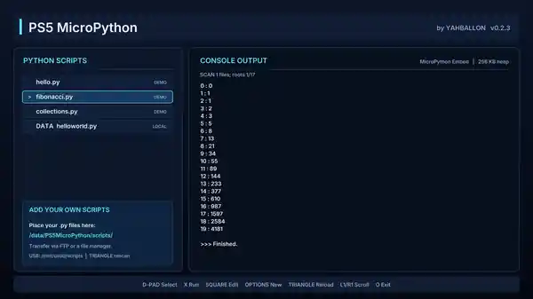

<div align="center">

# 🐍 PS5 MicroPython

### Write · Edit · Save · Run Python directly on your PlayStation 5

**Native PS5 homebrew · by YAHBALLON · v0.2.3 · PPSA99791**

[](https://github.com/Yahballon/PS5_MicroPython/releases/latest) [](#requirements-and-limitations) [](https://micropython.org/) [](LICENSE)

**[⬇ Download PPSA99791.zip](https://github.com/Yahballon/PS5_MicroPython/releases/latest/download/PPSA99791.zip)** · **[View Builds](https://github.com/Yahballon/PS5_MicroPython/actions/workflows/build-release.yml)**

</div>

## 🎮 Real PS5 screenshot

> Real capture of PS5 MicroPython v0.2.3 running a Fibonacci example and detecting a custom `helloworld.py` in DATA.



## About

PS5 MicroPython is a **native Python runner and editor for jailbroken PS5 consoles**, with the real embedded [MicroPython](https://github.com/micropython/micropython) VM, a controller-operated code editor, USB/DATA script browsing, and console output. It is not a website wrapper or an emulated screenshot.

## ✨ Features

- **Embedded MicroPython v1.26.1:** Run Python scripts on your PS5 and read the output on screen.
- **On-console code editor:** Compose `.py` files using the DualSense controller and the built-in lowercase, uppercase and symbol keyboards.
- **Create, edit and save:** Type code, insert newlines, indent with four spaces, backspace, move the cursor and save files across restarts.
- **Native DATA and USB loading:** Script discovery uses `sceKernelOpen` and `sceKernelGetdents`, with `sceKernelRead` for file loading.
- **Reliable saving:** Writes use `sceKernelWrite`, `sceKernelFsync` and `sceKernelRename`, with temporary files and on-screen error reporting.
- **Bundled examples:** `hello.py`, `fibonacci.py`, and `collections.py`.
- **Diagnostic logs:** View the scan status, reload scripts and inspect runtime logs.

## 📥 Installation

1. Download **[PPSA99791.zip](https://github.com/Yahballon/PS5_MicroPython/releases/latest/download/PPSA99791.zip)** from this repository’s Releases.
2. Extract the ZIP. It contains the `PPSA99791` app folder with `eboot.bin`, `sce_sys`, fonts and the Python examples.
3. Copy the `PPSA99791` folder to `/data/homebrew/` on your jailbroken PS5.
4. Launch the app using your compatible PS5 homebrew loader.

**Important:** Keep `/data/PS5MicroPython/` when updating. That folder stores your own Python scripts and logs, separately from the installed homebrew.

## 🗂️ Python script locations

| Storage | Path |
| --- | --- |
| PS5 DATA | `/data/PS5MicroPython/scripts/` |
| USB0 | `/mnt/usb0/scripts/` |
| USB0 alternative | `/mnt/usb0/PS5MicroPython/scripts/` |
| USB1–USB7 | Same subfolders under `/mnt/usb1` … `/mnt/usb7` |

Create a script right on the PS5 with **OPTIONS** → type using the on-screen keyboard → **OPTIONS** to save. New files are automatically numbered (for example, `script_001.py`). Editing a demo or a USB script creates a separate DATA copy instead of overwriting the original.

### Example script

```python
print("Hello from PS5!")
for i in range(5):
    print("MicroPython:", i)
```

Select the saved `.py` file and press **X** to execute. Maximum source file size: **64 KiB**.

## 🎮 DualSense controls

| Input | Script library | Python editor |
| --- | --- | --- |
| D-Pad / Left stick | Select a script | Select on-screen keyboard character |
| X | Run highlighted script | Type character |
| □ Square | Edit highlighted script | Backspace |
| △ Triangle | Reload script list | New line |
| OPTIONS | New script | Save |
| ○ Circle | Quit | Back / confirm discard |
| L1 / R1 | Scroll console | Move text caret left/right |
| L2 | — | Four spaces for Python indentation |
| R2 | — | Keyboard page: lower / upper / symbols |
| L3 / R3 | — | Move caret up/down one line |
| Touchpad | Clear console output | — |

## 🔧 Troubleshooting and logs

If your `.py` file is not listed, press **TRIANGLE** to rescan. Check the visible `SCAN` message and these diagnostic files:

```text
/data/PS5MicroPython/logs/scan.log
/data/PS5MicroPython/logs/runtime.log
```

Saving errors report the failing PS5 kernel step (`SAVE OPEN`, `SAVE WRITE` or `SAVE RENAME`) and its return code. Failed writes keep the previous saved script intact.

## 🧰 Build from source

All native C++ source, MicroPython embedding glue, bundled `.py` examples, the icon generator, host regression tests and the **[automatic PS5 GitHub Actions build](.github/workflows/build-release.yml)** are available here.

The workflow fetches the pinned MicroPython v1.26.1 source, provisions PS5-DevBridge and the native OpenGL SDK, runs host tests, builds the PS5 binary, validates the installer package and publishes `PPSA99791.zip` as a GitHub Release after a successful build.

## Requirements and limitations

- Jailbroken PS5 with a compatible homebrew environment. **Tested on firmware 5.10** (user-provided console screenshot).
- MicroPython is a small embedded Python implementation, **not full desktop CPython**: there is no `pip`, interactive REPL or arbitrary native Python extension support.
- Python execution is synchronous; an infinite loop can stall the homebrew until it is closed.
- Only execute Python code you trust.

## Credits and license

Made by **YAHBALLON**. The homebrew app is released under [GPL-3.0-or-later](LICENSE). MicroPython is copyright Damien P. George and contributors and is licensed under MIT. The project builds on PS5-DevBridge and PS5 Homebrew UI. See [THIRD_PARTY_NOTICES.md](THIRD_PARTY_NOTICES.md) for additional acknowledgments.

---

<div align="center"><sub>Built for the PS5 homebrew community · by YAHBALLON</sub></div>
